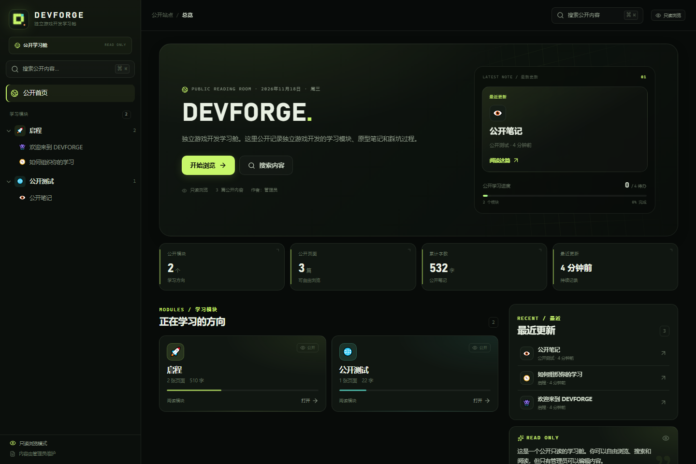
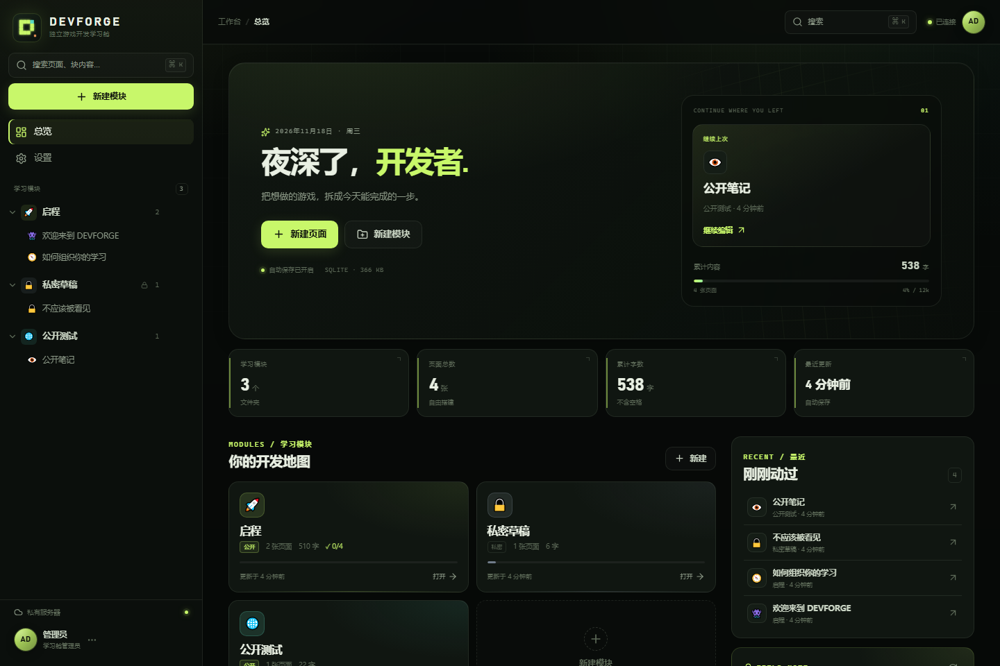
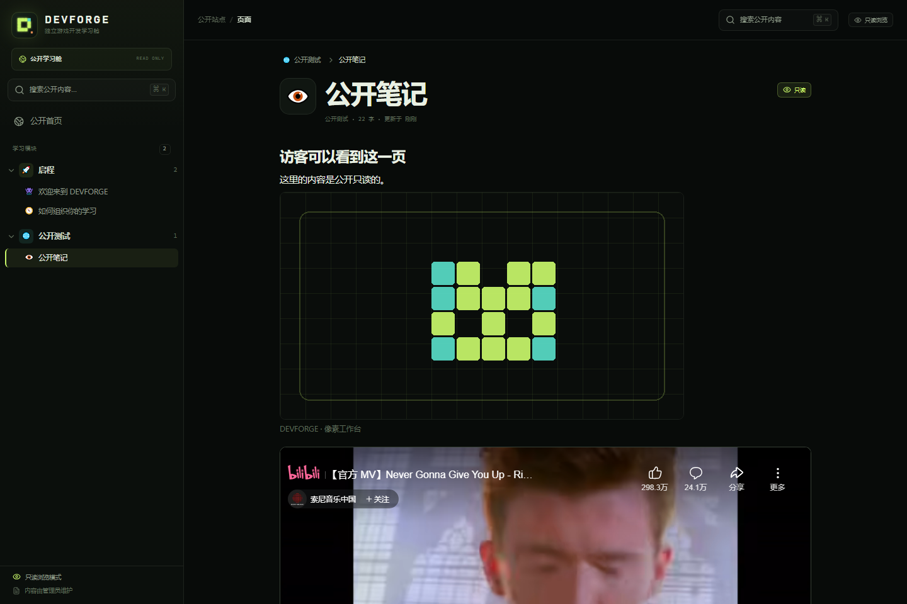

# DEVFORGE · 独立游戏开发学习舱

> 把想做的游戏，拆成今天能完成的一步。

一个**公开只读 + 单管理员编辑**的独立游戏开发学习工作台。访客可以自由浏览、搜索和阅读；只有管理员通过隐藏的 `/admin` 登录后才能编辑。用 Notion 式自由积木搭建模块、页面和笔记，数据保存在你自己的服务器上。



## 它是什么

- **公开只读站点**：任何人打开网址都能浏览公开模块、页面和笔记，不需要注册或登录。
- **只有一个管理员**：关闭公开注册，管理入口在 `/admin`，公开页面不显示登录入口，也不显示管理员账号。
- **模块级公开控制**：每个模块可以设为「公开」或「私密」。私密模块在公开站点完全不可见，只有登录后的管理员能看到。
- **模块 = 文件夹**：按方向组织学习内容，例如「Godot 入门」「像素美术」「玩法原型」。
- **页面 = 自由画布**：页面里可以放标题、正文、列表、待办、引用、代码、图片、视频嵌入、表格、文件、链接和分割线。
- **块编辑器**：输入 `/` 打开积木菜单，拖动手柄调整顺序，选中文字格式化。
- **自动保存**：每次修改自动写入 SQLite，刷新、换设备都不丢。
- **主题工坊**：默认 Forge 深灰 + 锻造橙，可切换深海终端、余烬、纸间三套预设，并调整主色、圆角、字号和密度。
- **待办进度**：页面里的勾选项会统计到模块进度和总览。
- **全局搜索**：公开站点和管理端都支持 `Ctrl / ⌘ + K` 搜索。
- **PWA**：可安装到桌面或手机主屏幕，不用上架应用商店。





第一次使用后台？看 **[使用手册](docs/USER-GUIDE.md)**：模块、页面、块编辑器、图片/视频、公开/私密和备份都有步骤说明。

## 技术栈

| 层 | 选型 |
| --- | --- |
| 前端 | React 19 + Vite + TypeScript |
| 编辑器 | BlockNote 0.57（Notion 风格积木内核） |
| 后端 | Node.js 24 + Fastify 5 |
| 数据库 | SQLite（Node 内置 `node:sqlite`，WAL 模式） |
| 部署 | Ubuntu 22.04 / 24.04 + systemd + Nginx（推荐）；Docker + Caddy（可选） |
| 证书 | Let's Encrypt / certbot，或阿里云免费 SSL |

## 本地运行

需要 **Node.js 24**（内置 `node:sqlite`）和 pnpm。

```bash
cd devforge
pnpm install
pnpm dev
```

- 前端：<http://127.0.0.1:5173>
- 后端：<http://127.0.0.1:3001>
- 首次启动会在终端打印初始化口令，也会写入 `data/setup-token.txt`。
- 打开页面后输入口令、设置管理员账号。**完成后：公开站点是 `/`，管理入口是 `/admin`**。
- `/admin` 不会出现在公开站点的导航里，建议直接收藏这个地址。
- 公开站点只展示「公开」模块；登录后在模块菜单里可以切换公开/私密。

生产模式本地预览：

```bash
pnpm build
pnpm start
# 公开站点：http://127.0.0.1:3001
# 管理入口：http://127.0.0.1:3001/admin
```

如果依赖已经安装、前端也已经构建（当前工作区就是这种状态），也可以直接：

```bash
node server/index.js
# 公开站点：http://127.0.0.1:3001
# 管理入口：http://127.0.0.1:3001/admin
```

第一次打开会要求输入初始化口令。口令在终端输出里，也会写入 `data/setup-token.txt`。

## 发布包

`release/devforge-1.0.0.zip` 是可直接上传到服务器的发布包，包含：

- 已构建的 `dist/`
- 后端 `server/`
- 部署脚本 `deploy/`
- 完整源码 `src/`（方便以后修改）
- 部署文档与截图

服务器上解压后用 `deploy/install-ubuntu.sh` 安装，详见部署文档。

## 数据在哪里

```text
data/
├── devforge.db        # 模块、页面、块内容、账号、主题
├── devforge.db-wal    # SQLite WAL
├── uploads/           # 图片、文件
├── backups/           # 数据库快照
└── setup-token.txt    # 首次初始化口令（设置完成后会删除）
```

整个 `data/` 目录就是全部数据。迁移服务器时复制它即可。

## 部署到阿里云

完整的购买、备案、部署、HTTPS、备份步骤见：

**[docs/DEPLOY-ALIYUN.md](docs/DEPLOY-ALIYUN.md)**

最短流程：

1. 购买阿里云 **ECS 99 元 e 实例**（2 核 2G / 3M / 40G / Ubuntu 22.04 或 24.04 / 大陆地域）或轻量应用服务器。
2. 购买域名，完成实名认证和 ICP 备案。
3. 上传发布包到 `/opt/devforge`。
4. `sudo bash /opt/devforge/deploy/install-ubuntu.sh`
5. 安全组放行 `8080`，打开 `http://公网IP:8080`，输入初始化口令。
6. 初始化完成后：访客访问 `http://公网IP:8080` 看到公开站点；你自己访问 `http://公网IP:8080/admin` 登录管理。
7. 备案通过、域名解析到服务器后：
   `sudo bash /opt/devforge/deploy/enable-https.sh 你的域名 你的邮箱`

> 大陆服务器使用域名对外提供网站服务需要 ICP 备案。备案期间可以先用 `IP:8080` 自用测试；正式开放前请完成备案。参考[阿里云 ICP 备案说明](https://www.alibabacloud.com/help/zh/icp-filing/basic-icp-service/product-overview/icp-filing-requirements-for-a-regular-website)。

## 公开站点与管理员

- **公开站点**：`/`、`/module/:id`、`/page/:id`。只返回 `is_public = 1` 的模块及其页面。
- **管理入口**：`/admin`。公开页面不显示这个链接，建议收藏。
- **公开/私密**：登录后，在模块菜单、模块编辑框或模块页右上角切换。设为私密后，公开 API 和公开页面都会立即隐藏该模块。
- 新建模块默认公开；从旧版本升级时，已有模块默认私密，需要手动点一次「公开到网站」。
- **只读隔离**：公开接口没有写入口；所有创建、修改、删除、上传、设置接口都要求管理员会话。即使访客手动构造请求，也会被后端拒绝。
- **账号隐私**：公开页面不显示管理员用户名，登录框不预填账号；密码永远不会出现在前端代码或页面中。
- **公开预览**：设置页提供「预览公开站点」，以访客视角检查后再发布。

## 备份

```bash
# 手动备份数据库 + uploads，保留 14 天
sudo bash /opt/devforge/deploy/backup.sh

# 每天 03:20 自动备份
sudo crontab -e
20 3 * * * /bin/bash /opt/devforge/deploy/backup.sh >> /var/log/devforge-backup.log 2>&1
```

建议再把 `data/backups/` 同步到阿里云 OSS 或另一台机器。数据库是单文件，恢复就是替换 `data/devforge.db`。

## 开源与自动更新

项目使用 **MIT License** 开源。

代码推到 GitHub 后，服务器可以通过 `devforge-update.timer` 每 2 分钟检查一次 `main` 分支：

- 更新前自动备份 SQLite 数据库；
- `data/`、`.env`、`uploads/` 不在 Git 中，更新不会覆盖；
- 构建或健康检查失败会自动回滚代码；
- 不会执行 `git clean`，不会删除运行时数据。

完整流程见 **[docs/UPDATES.md](docs/UPDATES.md)**。

```bash
# 本地
git add .
git commit -m "update"
git push origin main

# 服务器第一次接通 GitHub
sudo bash /opt/devforge/deploy/connect-github.sh https://github.com/你的用户名/devforge.git

# 查看自动更新日志
tail -f /var/log/devforge-update.log
```

> 默认 `main` 分支就是线上分支。更稳的做法是使用 `production` 分支，服务器只跟 `production`。

## 安全设计

- 关闭公开注册，只允许一个管理员账号。
- 公开站点只输出公开模块；私密模块的页面和搜索内容不会进入公开 API。
- 管理入口在 `/admin`，不出现在公开导航；公开页面不显示管理员账号。
- 密码使用 scrypt 加盐哈希；会话 Cookie 为 HttpOnly + SameSite=Lax；密码不会返回前端。
- 登录限流；修改请求校验 Origin；所有写接口强制管理员会话。
- 上传文件限制 MIME 和大小；图片/PDF 内联，其余强制下载；禁用 SVG 上传。
- 公开页面里的图片使用 `/api/public/assets/` 只读地址，私密页面资源仍需登录。
- Nginx 反向代理，Node 只监听 `127.0.0.1:3000`，不直接暴露。
- 演示/生产都可以通过 HTTPS 运行；HTTP 只用于备案前临时测试。
- 出租屋/动态 IP：SSH 22 平时可关闭，用阿里云 Workbench 管理；需要本地 SSH 时再临时放行当前 IP。
- 定期 `apt upgrade`，并保留至少一份服务器之外的备份。

## 常用命令

```bash
pnpm dev                 # 本地开发（前端 + 后端）
pnpm build               # 类型检查 + 构建前端
pnpm start               # 生产模式启动
pnpm test:e2e            # 浏览器端到端测试（需要本机 Chrome）
pnpm backup              # 数据库快照（本地开发）
pnpm reset-password      # 重置管理员密码
```

## 目录结构

```text
devforge/
├── src/                  # React 前端
│   ├── components/       # 编辑器、侧栏、对话框、搜索
│   ├── views/            # 管理端总览、模块、页面、设置
│   ├── public/           # 公开只读站点、公开搜索、只读编辑器
│   ├── state/            # 登录态与全局数据
│   ├── styles/           # 设计系统与编辑器主题
│   └── api.ts            # 后端 API 封装
├── server/               # Fastify + SQLite
│   ├── index.js          # API 与静态文件
│   ├── db.js             # 数据模型、迁移、搜索
│   ├── auth.js           # 密码、会话、限流
│   └── backup.js         # SQLite 快照
├── deploy/               # Ubuntu 安装、Nginx、systemd、HTTPS、备份、自动更新
├── docs/                 # 部署、更新文档与截图
├── .github/workflows/    # GitHub Actions CI
├── public/               # PWA 图标、robots
├── data/                 # 运行时数据（不提交）
├── release/              # 本地发布包（不提交）
└── dist/                 # 构建产物（不提交）
```

## 已知边界

- 单管理员，不提供多人协作、评论、实时同步。
- 公开/私密以模块为单位；同一个公开模块里的页面都会公开。
- 没有版本历史；依赖数据库快照备份。
- 图片/文件存在服务器磁盘，未接 OSS/CDN；数据量大时再迁移。
- 视频嵌入支持 B 站、YouTube、Vimeo 和 MP4/WebM 直链；其他站点会显示为链接卡片。
- 搜索使用 SQLite `LIKE`，适合个人规模数据。

## 设计原则

做小，做完，再做下一个。

---

DEVFORGE v1.0.0 · 公开只读 · 单管理员 · 自托管 · PWA

## AI 助手

管理员后台右下角内置 AI 助手（DeepSeek / OpenAI 兼容接口）。配置方式见 **[docs/AI-DEEPSEEK.md](docs/AI-DEEPSEEK.md)**。API Key 只保存在服务器 `.env`，不会进入 Git，也不会暴露给公开访客。
