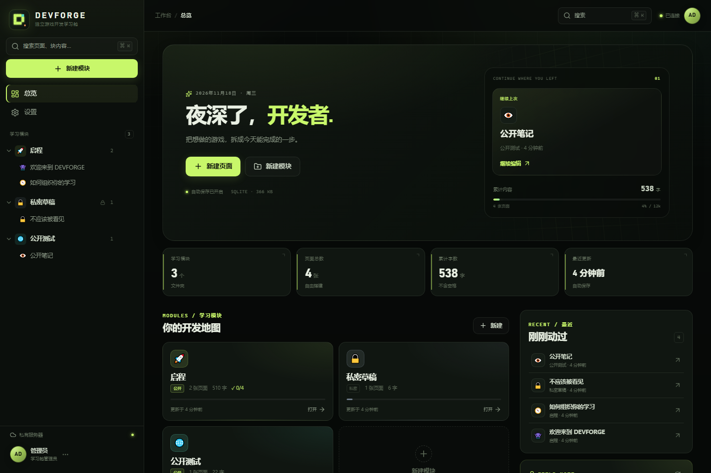
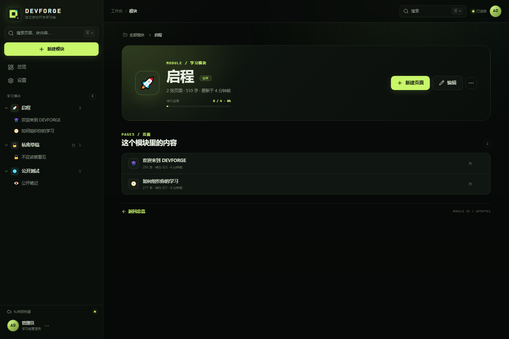
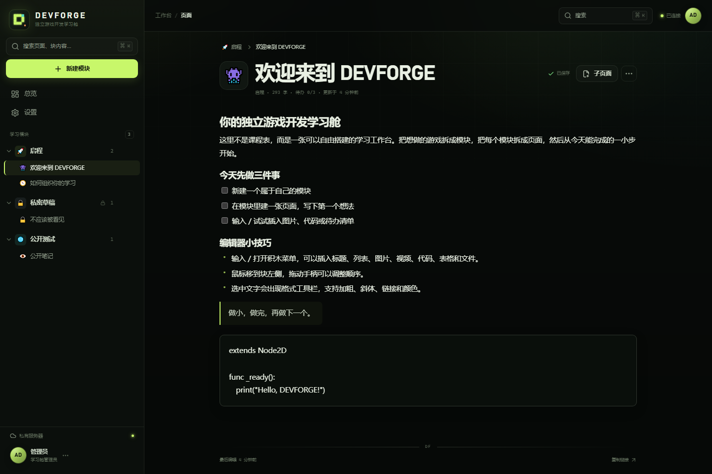
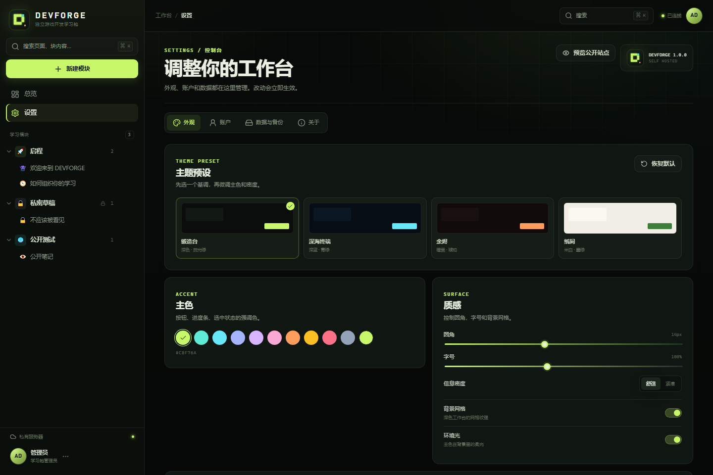

# DEVFORGE 使用手册

> 给你的个人游戏开发学习站：`ygamecraft.cn`
>
> 备案期间先用：`http://<服务器公网IP>:8080/admin`
> 备案和 HTTPS 完成后用：`https://ygamecraft.cn/admin`
>
> 如果备案系统提示域名数据同步需要约 3 天，这 3 天仍然用 IP 登录和管理。现在写的内容不会因为以后换域名而丢失。
>
> 一句话理解：
> **模块 = 文件夹；页面 = 文件夹里的文章；块 = 文章里的一段积木。**

---

## 0. 先记住三件事

1. **入口页和管理端**
   - 所有人进入：`http://<服务器公网IP>:8080/`
   - 先看到登录/游客入口页；
   - 管理员登录后进入管理端；
   - 没有账号点「以游客身份进入」，进入只读公开站；
   - 管理入口也可以直接打开：`/admin`。

2. **没有“保存”按钮**
   - 写完停一会儿，右上角显示 **已保存** 就保存好了。
   - 显示 **未保存 / 保存中** 时不要急着关页面。

3. **模块控制公开/私密**
   - 新模块默认是 **公开**。
   - 还没准备好看的内容，先在模块菜单里设为 **私密**。

---

## 1. 登录、游客和退出

### 入口页

打开：

```text
http://<服务器公网IP>:8080/
```

会先进入入口页：

- 有管理员账号：输入用户名和密码，进入管理端；
- 没有账号：点 **「以游客身份进入」**，进入只读公开站。

游客状态只在当前标签页有效。新开一个标签页，会重新回到入口页。

### 直接登录管理端

```text
http://<服务器公网IP>:8080/admin
```

输入你初始化时设置的用户名和密码。

- 登录页不会显示你的账号；
- 公开页面也不会显示管理员用户名；
- 密码不会出现在网页源代码里。

### 退出

左下角点：

```text
管理员  →  退出登录
```

数据已经保存在服务器，退出不会丢。

### 建议收藏

把 `/admin` 收藏到浏览器书签。新标签页默认回到入口页，不会直接进管理端。

---

## 2. 认识后台界面



界面分三块：

- **左侧栏**：总览、设置、所有模块和页面。
- **中间**：当前页面内容。
- **顶部**：搜索、保存状态、页面操作。

左侧栏最上面：

```text
+ 新建模块
```

左侧栏最下面：

```text
管理员  →  账户与设置 / 退出登录
```

---

## 3. 建第一个模块

模块就是“文件夹”，用来分类。例如：

```text
Godot 入门
像素美术
玩法原型
踩坑记录
素材库
```

### 操作

1. 点左侧 **「+ 新建模块」**。
2. 填 **模块名称**。
3. 选一个 **图标**（🎮、🧩、🎨 都可以）。
4. 也可以点 **「上传自定义图标」**，选一张图片：
   - 会自动压缩到最大 **256×256** 的 WebP；
   - 上传后，这张图会自动变成侧栏、模块卡片、模块页和公开站里的小图标；
   - 点「恢复 emoji」可以切回图标字体。
5. 选一个 **主题色**。
6. 看 **「公开到网站」** 开关：
   - 打开：访客能看到；
   - 关闭：只有你登录后能看到。
7. 点 **保存模块**。

### 子模块

在模块菜单里点 **「新建子模块」**，子模块可以继续嵌套，层级不限。

公开/私密会沿父模块继承：父模块私密，子模块里的内容也不会出现在公开站。

### 建完之后

模块会出现在左侧栏。鼠标移到模块上，点右边的 `···`，可以：

- 新建页面
- 编辑模块
- 设为私密 / 公开到网站
- 上移 / 下移
- 删除模块

> 删除模块会把里面的页面一起删除，不能撤销。删之前先导出备份。

---

## 4. 建页面、写第一篇笔记



1. 点左侧某个模块。
2. 点 **「新建页面」**。
3. 页面会自动打开，标题是「未命名页面」。
4. 点标题，改成你想写的名字，例如：
   ```text
   第一天：安装 Godot
   ```
5. 点正文区域，开始写。

### 页面里的操作

右上角：

- **子页面**：在当前页面下再建一层页面。
- **页面菜单 `···`**：
  - 导出 Markdown
  - 复制页面链接
  - 新建子页面
  - 删除页面

> 复制出来的页面链接只有在该模块「公开」时，访客才能打开；私密模块的链接对访客会显示“页面不存在或未公开”。

### 页面标题下面

会显示：

```text
模块名 · 字数 · 待办进度 · 更新时间
```

这些是自动统计的，不用手动填。

### 关联其他笔记（双链）

不用手打标题也可以：

1. 把光标放到正文要插入的位置；
2. 点正文上方的 **「关联笔记」**；
3. 输入关键词搜索页面或模块；
4. 点选目标，链接会插入到当前光标。

也可以直接输入：

```text
[[页面标题]]
```

或者输入 `/关联` 打开同一个选择器。

例如：

```text
下一步参考 [[第一天：安装 Godot]]。
```

链接到整个模块：

```text
[[模块:启程]]
```

保存后，页面底部的 **「知识链接」抽屉** 会记录：

- **出链**：这篇笔记指向了哪些页面/模块；
- **反向链接**：哪些页面提到了这篇笔记；
- 点条目标题会在当前页面弹出 **快速预览窗口**，显示目标内容，不会跳走；
- 未创建的页面会显示「未创建」；点「创建」可以直接建同名页面。

正文里的链接会自动显示为当前主题色的超链接，名字就是目标文档名称；点击也是弹出快速预览窗口，不会离开当前页面。

也可以给链接起别名：

```text
[[第一天：安装 Godot|安装步骤]]
```

> 当前版本已有双链、选择器、内联超链接和抽屉；公开站也有只读的知识链接抽屉，还没有关系图谱。

---

## 5. 编辑器怎么用



### 5.1 输入 `/` 打开积木菜单

在正文里另起一行，输入：

```text
/
```

会弹出菜单，常用选项：

| 输入 | 作用 |
| --- | --- |
| `/标题` | 大标题、二级标题、三级标题 |
| `/列表` | 无序列表、有序列表 |
| `/待办` | 勾选框，可统计进度 |
| `/引用` | 引用一段话 |
| `/代码` | 代码块，适合放脚本 |
| `/表格` | 插入表格 |
| `/图片` | 上传图片 |
| `/视频` | 上传或嵌入视频 |
| `/文件` | 上传附件 |
| `/分割线` | 分隔内容 |
| `/视频嵌入` | B 站、YouTube、Vimeo、MP4 链接 |

> 菜单里显示的中文名称可能略有不同，认关键词即可。

### 5.2 调整顺序

每段文字左边会出现：

- **`+`**：在下面加一段
- **`⋮⋮` 手柄**：按住拖动，调整顺序

### 5.3 选中文字

选中文字后会出现工具栏，可以加粗、斜体、链接、颜色等。

### 5.4 保存状态

右上角：

```text
已保存     → 正常
保存中     → 等一两秒
未保存     → 不要关页面
保存失败   → 点“重试”
```

如果一直失败，先检查网络，再刷新页面。

---

## 6. 插入图片、文件、视频

### 图片

1. 新起一行，输入 `/图片`。
2. 选择本机图片。
3. 上传完成后会直接显示。

也可以直接把图片拖进编辑器，或粘贴截图。

注意：

- 单文件默认最大 **25MB**；
- 支持常见图片格式；
- 不允许上传 SVG。

### 文件 / 素材

输入 `/文件`，上传 zip、pdf、素材包等。

公开页面里的文件会通过公开只读地址访问；私密模块里的文件仍然需要登录。

### B 站 / YouTube 视频

1. 输入 `/视频嵌入`。
2. 粘贴视频链接，例如：
   ```text
   https://www.bilibili.com/video/BV...
   ```
3. 回车，出现播放器。

支持：

- B 站
- YouTube
- Vimeo
- MP4 / WebM 直链

其他网站会显示成链接卡片。

---

## 7. 待办、进度、代码、表格

### 待办清单

输入 `/待办`，每行一个任务：

```text
☐ 安装 Godot
☐ 跑通第一个场景
☑ 创建项目
```

勾选后，模块页和总览会自动统计进度。

### 代码块

输入 `/代码`，选择语言，粘贴代码。

适合放：

- GDScript
- C#
- 着色器
- 终端命令

### 表格

输入 `/表格`，适合：

- 素材清单
- 数值表
- 学习计划
- 版本记录

---

## 8. 公开 / 私密

### 规则

公开/私密是 **按模块** 控制的：

- 模块公开 → 模块里的所有页面都公开；
- 模块私密 → 整个模块在公开站消失；
- 私密模块的页面直接访问会显示“页面不存在或未公开”。

### 在哪里切换

三个地方都可以：

1. 左侧模块右边的 `···` → **设为私密 / 公开到网站**
2. 模块页右上角 `···`
3. 编辑模块弹窗里的 **公开到网站** 开关

### 公开前建议

1. 点左侧 **设置**。
2. 点右上角 **预览公开站点**。
3. 以访客视角检查。
4. 看完点 **返回管理**。

### 备案期间特别提醒

新模块默认公开。如果你不想在备案完成前被看到：

- 建模块时关闭 **公开到网站**；
- 或者建完后马上在模块菜单里设为 **私密**；
- 等内容整理好，再逐个公开。

---

## 9. 搜索

按：

```text
Ctrl + K    （Windows）
⌘ + K       （Mac）
```

可以搜：

- 页面标题
- 页面正文
- 块内容

公开站也有搜索，但只搜得到公开内容。

---

## 10. AI 助手（仅管理员）

登录管理端后，右下角有一个 **AI** 按钮：

```text
✨ AI
```

点开后可以：

- 总结当前页面
- 根据笔记回答问题
- 找相关笔记

AI 会读取当前页面和搜索到的相关笔记，并列出参考页面。公开站访客看不到这个按钮。

第一次使用需要服务器先配置 DeepSeek API Key，完整步骤见 **[AI-DEEPSEEK.md](AI-DEEPSEEK.md)**。

## 11. 设置



### 外观

- 主题预设：深色工作台、深海终端、余烬、纸间
- 主色
- 圆角
- 字号
- 信息密度：舒适 / 紧凑
- 背景网格
- 环境光

改完立即生效，停止操作后自动保存。

### 站点

- **站点名称**：管理端和公开站的品牌名
- **副标题 / 标语**：显示在名称下面、公开首页
- **站点图标**：上传后自动压缩到最大 **512×512** 的 WebP

保存后立即生效。访客刷新页面就能看到新的站点名和图标。页面正文里以前写死的旧名称不会自动替换，需要手动改。

### 账户

- 显示当前管理员用户名
- **修改管理员用户名**：需要当前密码
- 修改密码
- 退出登录

用户名只影响登录，公开站不会显示它；公开页脚仍然是「作者：管理员」。

### 数据与备份

- **导出 JSON**：导出所有模块、页面、块、主题。
  - 不包含上传的图片和附件。
- **服务器备份**：数据库快照在服务器的 `data/backups/`。
- 图片和文件在服务器的 `data/uploads/`。

需要完整备份时，数据库和 uploads 都要备份。

### 关于

- 版本号
- PWA 安装
- 备案号（备案通过后显示）

### 安装到桌面 / 手机

- Windows / Mac：Chrome 或 Edge 地址栏右侧的安装图标
- Android：Chrome 菜单 →「安装应用」
- iPhone / iPad：Safari 分享菜单 →「添加到主屏幕」

安装后像 App 一样打开，但数据仍在你的服务器。

---

## 11. 日常写法模板

### 学习笔记

```text
今天的目标
- 

学到的概念
- 

代码 / 命令
- 用 `/代码` 插入代码块

踩坑
- 

明天继续
- 
```

### 游戏原型记录

```text
原型目标


核心玩法


参考图 / 视频


本周待办
☐ 
☐ 
☐ 
```

### 素材库

建一个「素材库」模块，页面按类型分：

```text
像素角色
场景参考
UI 图标
音效
```

图片直接上传，文件名写清楚来源和授权。

### 每周复盘

```text
本周完成
- 

卡住的地方
- 

下周只做一件事
- 
```

---

## 12. 数据安全

### 会自动保存

每次修改都会自动写入服务器的 SQLite 数据库，刷新和换设备都不丢。

### 不要做的事

- 不要删除服务器上的 `/opt/devforge/data/`；
- 不要在服务器上执行 `git clean`；
- 不要把 `.env` 发到公开仓库；
- 不要用公开仓库里的密码示例当真实密码。

### 备份

网页端可以导出 JSON：

```text
设置 → 数据与备份 → 导出 JSON
```

服务器端可以生成数据库 + uploads 备份：

```bash
sudo bash /opt/devforge/deploy/backup.sh
```

GitHub 自动更新在每次更新前也会先备份数据库；更新不会覆盖 `data/` 和 `.env`。

站点名称、图标、用户名、页面内容都保存在 `data/devforge.db` 或 `data/uploads/`，这些不在 Git 里，所以线上修改不会和自动更新冲突。

---

## 13. 常见问题

### 为什么打开网站先看到登录页？

这是入口页。管理员登录后进入管理端；没有账号点「以游客身份进入」，就是只读公开站。新标签页会重新显示入口页。

### 域名打不开？

备案没完成前，域名不能用。先用：

```text
http://<服务器公网IP>:8080/admin
```

### 页面显示“页面不存在或未公开”？

说明：

- 模块是私密的；或
- 页面属于私密模块；或
- 链接不完整。

### 图片上传失败？

- 文件超过 25MB；
- 格式不支持；
- 网络中断；
- 服务器磁盘满。

### 保存失败？

点右上角 **“保存失败 · 重试”**。如果一直失败，刷新页面，内容一般还在编辑器的本地状态里。

### 忘了密码？

需要在服务器上重置，不能在网页端找回。可以让管理员执行重置命令。

### 公开站看不到新页面？

检查：

1. 模块是否公开；
2. 是否点了「预览公开站点」；
3. 浏览器是否缓存，按 `Ctrl + F5`。

### 修改了内容，别人多久能看到？

保存成功后立即生效；公开站刷新就能看到。

---

## 14. 上线后要改的地址

备案通过、HTTPS 配置完成后：

```text
公开站：https://ygamecraft.cn/
管理端：https://ygamecraft.cn/admin
```

到时候把书签从 IP 换成域名即可。服务器里的内容不会变。

---

## 15. 最简上手路线

如果只想先跑起来，按这个顺序：

1. 登录 `/admin`
2. 新建模块「我的游戏开发」
3. 模块先设为 **私密**
4. 新建页面「第一天」
5. 用 `/标题`、`/待办`、`/代码` 写三条内容
6. 等右上角显示「已保存」
7. 点「设置 → 预览公开站点」看效果
8. 准备好后再把模块改为「公开到网站」

就这些。先把内容写起来，样式和发布都可以慢慢调。
